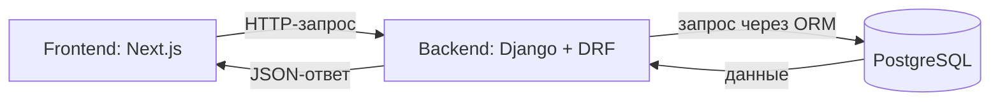

# STUDLY: с чего начать Backend

Актуальный статус 16 октября 2026 года: работаем только над Backend. Frontend заменён точной версией `origin/main` (`ccfde59`); прежняя локальная интеграция убрана в резервную копию. Сейчас Frontend друга к нашему API не подключён. Реализованы Telegram-обработчики, каталог, создание и редактирование услуг с повторной модерацией, предварительный расчёт суммы заказчика с надбавкой 3%, оформление заказа со снимком условий и согласие исполнителя; все 109 тестов прошли. После согласия заказ ожидает оплаты. Для первой версии выбран отдельный сайт с Telegram-входом и рублёвой оплатой; настоящие платежи, выполнение заказов, баланс и выплаты ещё не реализованы. При разработке доступен браузерный просмотр API; для наблюдения используем Safari и PyCharm. Инструкция: [RUN_LOCAL.md](RUN_LOCAL.md); действующий API: [API_CONTRACT.md](API_CONTRACT.md); текущий этап: [BACKEND_NEXT.md](BACKEND_NEXT.md). Замечания другу: [FRONTEND_ISSUES.md](FRONTEND_ISSUES.md).

Ниже сохранена история первоначального планирования и прежней локальной интеграции. Та интеграция впоследствии убрана после уточнения владельцем разделения работы. Прежние 12 браузерных сценариев не подтверждают работу актуального Frontend с API. Настоящий вход Telegram ждёт постоянного HTTPS, внешних настроек и подключения интерфейса разработчиком Frontend.

Упоминания страниц, зависимостей и дальнейших этапов ниже относятся к моменту первоначального исследования. Часть этапов уже выполнена; текущий Frontend использует собственные демонстрационные данные. Исходные четыре услуги Backend находятся в [команде заполнения](apps/api/catalog/management/commands/seed_demo_catalog.py).

Ты уточнил, что STUDLY — ваш будущий бизнес-проект с другом, а предпочтительный язык Backend — Python. После обсуждения ты подтвердил Python, Django, Django REST Framework и PostgreSQL и разрешил начать с каркаса, отдельного окружения, маршрута health и его теста. Ниже зафиксированы причины выбора, границы этапов и последовательность работы.

Архив `/Users/viktorkovarov/Downloads/Studly-main-2.zip` проверен на целостность. При начальном сравнении, до реализации Backend, все 46 файлов проекта в нём побайтово совпали с файлами рабочей папки. Служебные файлы macOS `__MACOSX` и `._*` не учитывались как исходники проекта. В архиве нет корневых `AGENTS.md` и `DIAGNOSTICS.md`, которые есть в рабочей папке. Поэтому предыдущая [диагностика](DIAGNOSTICS.md) описывает исходное состояние и этой версии. Исходники из архива не перезаписывались, содержимое документов архива использовалось как материал для исследования.

Сейчас Frontend уже показывает услуги и исполнителей, но данные записаны в исходниках: [услуги](apps/web/src/app/service/[id]/page.tsx#L12), [профили](apps/web/src/app/profile/[id]/page.tsx#L10). Кнопка [«Оплатить»](apps/web/src/components/CreateOrderButton.tsx#L20) создаёт только локальный заказ. [Модерация](apps/web/src/app/create-service/page.tsx#L71) ограничивается уведомлением. Поэтому переносить все действия интерфейса в серверный код без уточнений пока нельзя: часть бизнес-правил ещё не определена.

Начать стоит с одного проверяемого результата: сервер запускается, читает услуги из PostgreSQL и возвращает их через API. API — это договорённость о запросах и ответах между Frontend и Backend. Например, Frontend запрашивает услугу с ID `1`, Backend находит её в базе и возвращает JSON. После этого отдельно подключается интерфейс. Python и TypeScript в такой схеме обмениваются JSON; переписывать Frontend на Python не требуется.

Для начала предлагается следующая основа:

| Часть | Предложение | Зачем она нужна |
|---|---|---|
| Язык | Python 3.13, с фиксацией версии окружения | Соответствует твоему предпочтению; эта ветка уже доступна на компьютере |
| Сервер | Django 5.2 LTS, актуальное исправляющее обновление этой ветки | Обработка запросов, настройки проекта, модели данных, миграции, механизм пользователей и административная панель |
| API | Django REST Framework, версия, совместимая с выбранным Django | Преобразование данных в JSON, проверка входных данных, права доступа и инструменты тестирования API |
| База данных | PostgreSQL, поддерживаемая версия, совместимая с Django | Постоянное хранение связанных данных: пользователей, услуг и впоследствии заказов |
| Работа с БД | Встроенная Django ORM | Описание таблиц Python-классами и запросы к данным; отдельный ORM на старте не нужен |
| Изоляция зависимостей | Отдельное виртуальное окружение Backend и зафиксированные зависимости | У вас с другом должно воспроизводиться одно окружение; системный Python не должен определять зависимости проекта |
| Проверки | Встроенный тестовый механизм Django и API-тесты DRF | Проверять реальные ответы HTTP и работу с тестовой БД с первых этапов |

Этот выбор обоснован текущей задачей: у платформы есть пользователи, публикации и административные действия. Django уже предоставляет общий механизм учётных записей и административный интерфейс, которые иначе пришлось бы собирать отдельно. Конкретные роли STUDLY, регистрацию, восстановление доступа и права на отдельные заказы всё равно нужно спроектировать. Наличие Django не реализует эти сценарии автоматически. Подтверждение возможностей: [аутентификация Django](https://docs.djangoproject.com/en/5.2/topics/auth/), [модели, миграции и admin](https://docs.djangoproject.com/en/5.2/intro/tutorial02/), [DRF](https://www.django-rest-framework.org/).

Django 5.2 выбран как поддерживаемая LTS-ветка с расширенной поддержкой до апреля 2028 года, а не как утверждение, что это самая новая версия. Python 3.13 совместим с ней. Перед установкой следует закрепить конкретные исправляющие версии совместимых пакетов. Источники: [сроки поддержки Django](https://www.djangoproject.com/download/), [совместимость Python](https://docs.djangoproject.com/en/5.2/releases/5.2/), [требования DRF](https://www.django-rest-framework.org/#requirements).

Предлагаемая схема — один Backend, разделённый внутри на Django-приложения по назначению, и одна PostgreSQL. Такое приложение обычно называют модульным монолитом. Это позволит держать серверную логику в одном проекте и проверять её вместе. Обоснований выделять отдельные сетевые сервисы по текущим требованиям нет.



Для первого этапа достаточно конфигурации сервера, проверки его запуска и каталога. Позднее, по мере согласования сценариев, добавляются приложения пользователей, заказов и сообщений. Полная схема данных всей платформы сейчас не фиксируется.

Backend размещён в `apps/api`; [корневая команда `dev:api`](package.json#L11) уже обновлена и запускает Django через его Python-окружение. Корневые npm-команды сборки и lint не проверяют Python-код автоматически. Frontend находится в `apps/web`; его интеграция с API будет отдельным изменением.

Дальше предлагаю работать такими небольшими этапами:

1. **Подготовить основу сервера.** Создать `apps/api`, отдельное окружение, закреплённые зависимости, настройки окружения и инструкцию запуска. Добавить `GET /api/v1/health/` и тест его ответа. Этот этап даёт запускаемый сервер без необходимости заранее придумывать жизненный цикл заказов. Команда проверки состояния подтверждает работу HTTP-сервера; состояние БД оценивается отдельно. Миграции пользовательской модели не применять до следующего решения.

2. **Подготовить БД и минимальную модель каталога.** До первой миграции определить основу пользовательской модели и связь исполнителя с услугой. Для нового проекта предлагается собственная модель пользователя на базе средств Django, чтобы её можно было развивать внутри STUDLY. Владелец проекта подтвердил вход через Telegram как из Mini App, так и с отдельного сайта; один аккаунт может заказывать и выполнять услуги. Схема входа и общий пользователь описаны в [TELEGRAM_AUTH.md](TELEGRAM_AUTH.md). Затем описать только необходимые для чтения каталога данные, создать миграции, подключить PostgreSQL и добавить явно демонстрационные записи. Источник рекомендации о модели пользователя: [Django: starting a new project](https://docs.djangoproject.com/en/5.2/topics/auth/customizing/#using-a-custom-user-model-when-starting-a-project).

3. **Сделать API чтения услуг.** Реализовать список и детальную услугу, проверку отсутствующего ID, пагинацию и тесты. Записи должны читаться из БД. Данные после перезапуска приложения должны сохраняться. Запись через публичное API на этой итерации не предлагается: для неё нужны согласованные права и правила публикации.

4. **Подключить один экран Frontend после разрешения на его изменение.** Заменить данные одной страницы ответом API, обработать загрузку, отсутствие записи и ошибку сервера. Это покажет, что вся цепочка Next.js → Django → PostgreSQL работает. До этой интеграции API можно проверять отдельно HTTP-запросами.

5. **Развивать продукт по согласованным сценариям.** Следующими кандидатами являются вход и профиль, публикация услуг с нужными правами, затем заказы и чат. Платежи зависят от того, как вы определите оформление заказа, оплату, выплату исполнителю, возврат и спор. Их место в MVP и порядок реализации требуется решить с вами.

Для этапов 1–3 предлагается следующий черновой контракт. Пути и формат ниже ещё не реализованы; они вынесены сюда, чтобы обсуждать конкретный результат.

| Запрос | Предлагаемое поведение |
|---|---|
| `GET /api/v1/health/` | `200` и `{"status": "ok"}`, если HTTP-приложение работает; не является проверкой БД |
| `GET /api/v1/services/` | `200`, список услуг из БД с полями `count`, `next`, `previous`, `results`; предлагаемый размер страницы — 20 записей, стабильная сортировка по ID |
| `GET /api/v1/services/1/` | `200`, данные конкретной услуги; `404`, если записи нет |

Для первой итерации предлагается разрешить анонимное чтение именно этого каталога. Это не определяет права доступа ко всем будущим разделам STUDLY. Публичное создание, изменение и удаление услуг в эти маршруты не включаются.

Пример предлагаемого ответа детальной услуги основан на [существующей услуге ID 1](apps/web/src/app/service/[id]/page.tsx#L13):

```json
{
  "id": 1,
  "title": "Помогу с C++",
  "description": "Помогу выполнить лабораторные работы, исправить ошибки в коде, объяснить сложные темы по C++.",
  "price_amount": "500.00",
  "currency": "RUB",
  "duration_days": 3,
  "performer": {
    "id": 1,
    "name": "Иван Петров"
  },
  "included": [
    "Консультация",
    "Проверка кода",
    "Исправление ошибок"
  ]
}
```

Здесь `500 ₽` разделено на сумму и валюту, а `3 дня` представлено числом дней. Это предложение формата обмена, а не изменение цены или срока. Для хранения суммы предлагается точное десятичное значение; JSON передаёт сумму строкой с определённой точностью. Frontend позже форматирует её для показа. ID выдаёт база; `Date.now()` из браузера не становится серверным идентификатором.

Рейтинг и статистика профилей в текущем коде демонстрационные. Пока правила отзывов и расчёта не согласованы, не следует выдавать эти числа за реальные показатели платформы. Также нельзя автоматически приписывать услугам категории по их названиям: текущая [страница категории](apps/web/src/app/category/[slug]/page.tsx#L28) показывает общий массив, а не подтверждённые связи. Для первой версии API категории и статистика оставлены за пределами этого чернового ответа.

Готовность первого результата предлагается оценивать по следующим проверкам:

- Новый разработчик может создать окружение и запустить Backend по инструкции с зафиксированными версиями пакетов.
- `health` отвечает ожидаемым JSON; отдельный API-тест подтверждает статус и формат.
- Миграции создают схему в пустой тестовой PostgreSQL; тесты используют тестовую БД, а не рабочие данные.
- Список читает записи из БД, правильно возвращает пустой список и страницы в стабильном порядке.
- Детальная услуга возвращает связанные данные исполнителя, цену и срок в согласованном формате; отсутствующая запись даёт `404`.
- Попытки публичной записи через маршруты чтения не меняют данные.
- Изменение записи в тестовой БД отражается в API; перезапуск приложения не теряет сохранённые записи.
- Проверены системные проверки Django, отсутствие незаписанных изменений моделей и все API-тесты. Инструменты для таких тестов предоставляет [DRF](https://www.django-rest-framework.org/api-guide/testing/).

Для старта каркаса не требуется отвечать на все вопросы будущего бизнеса. Два вопроса о пользователе уже решены: нужны оба варианта входа через Telegram, а один аккаунт может одновременно быть заказчиком и исполнителем. Предлагаемая реализация и оставшиеся технические вопросы зафиксированы в [TELEGRAM_AUTH.md](TELEGRAM_AUTH.md). Следом понадобятся правила публикации/модерации и переходов заказа. Полный исходный перечень вопросов есть в [диагностике](DIAGNOSTICS.md).

Перед реализацией зафиксировано состояние среды:

| Проверка | Результат |
|---|---|
| `python3 --version` | Python `3.9.6`; эту команду нельзя считать выбранным окружением Backend |
| `python3.13 --version` | Python `3.13.5`, путь `/Library/Frameworks/Python.framework/Versions/3.13/bin/python3.13` |
| Наличие Django, DRF, psycopg в этом Python | Не обнаружены. Для проекта следует использовать отдельное окружение и актуальные совместимые исправляющие версии |
| Docker CLI и Compose | Команды доступны; готовность Docker daemon и наличие запущенной PostgreSQL не проверялись |
| Зависимости Frontend | `node_modules` отсутствует; в этом проходе сборка и lint повторно не запускались |
| История Git | Ни в архиве, ни в корне рабочей копии нет собственной `.git`. Перед командной разработкой нужно получить нормальный checkout репозитория по его реальному адресу; адрес не угадывался |

После первого согласования создан каркас `apps/api`, отдельное Python-окружение и маршрут `GET /api/v1/health/` с API-тестами. Установлены Django `5.2.18`, DRF `3.18.3`, psycopg `3.3.6`; прямые и транзитивные версии зафиксированы в [requirements.txt](apps/api/requirements.txt). Команда `dev:api` в корневом package.json обновлена для запуска Django. После уточнения Telegram-входа и разрешения реализовывать добавлены локальная PostgreSQL 17, пользовательская модель, миграции и маршруты входа/сессии. Для OIDC используется Authlib; локальный `.env` автоматически читается через python-dotenv. Frontend не изменялся. Инструкция запуска находится в [README Backend](apps/api/README.md).

Первоначально каркас прошёл два теста без БД и проверку HTTP `health`. После добавления авторизации миграции успешно применены в локальной PostgreSQL; 33 теста прошли с отдельной тестовой БД, включая подписи, сессии и одновременный первый вход. `manage.py check` — без замечаний; `makemigrations --check --dry-run` — изменений нет; `pip check` — конфликтов зависимостей нет. Затем владелец создал бота, токен подтверждён Telegram и подключён к перезапущенному Backend. Успешный вход настоящего пользователя ещё не проверен: нужны HTTPS-адреса, настройки OIDC и подключение интерфейса. Текущее состояние: [TELEGRAM_SETUP.md](TELEGRAM_SETUP.md). Для установки пакетов, Docker, подключения к локальной БД и Telegram использовались отдельно одобренные разрешения среды исполнения.

Условие ваших [инструкций проекта](AGENTS.md#L27) «До согласования архитектуры не приступай к реализации Backend» выполнено: реализация началась после явного подтверждения пользователя. Серверная часть [плана авторизации](TELEGRAM_AUTH.md) реализована. Далее нужны настройка собственного бота и проверка настоящего входа; подключение Frontend остаётся отдельным изменением после разрешения. Черновой контракт каталога выше сохраняется как отдельная следующая задача.
