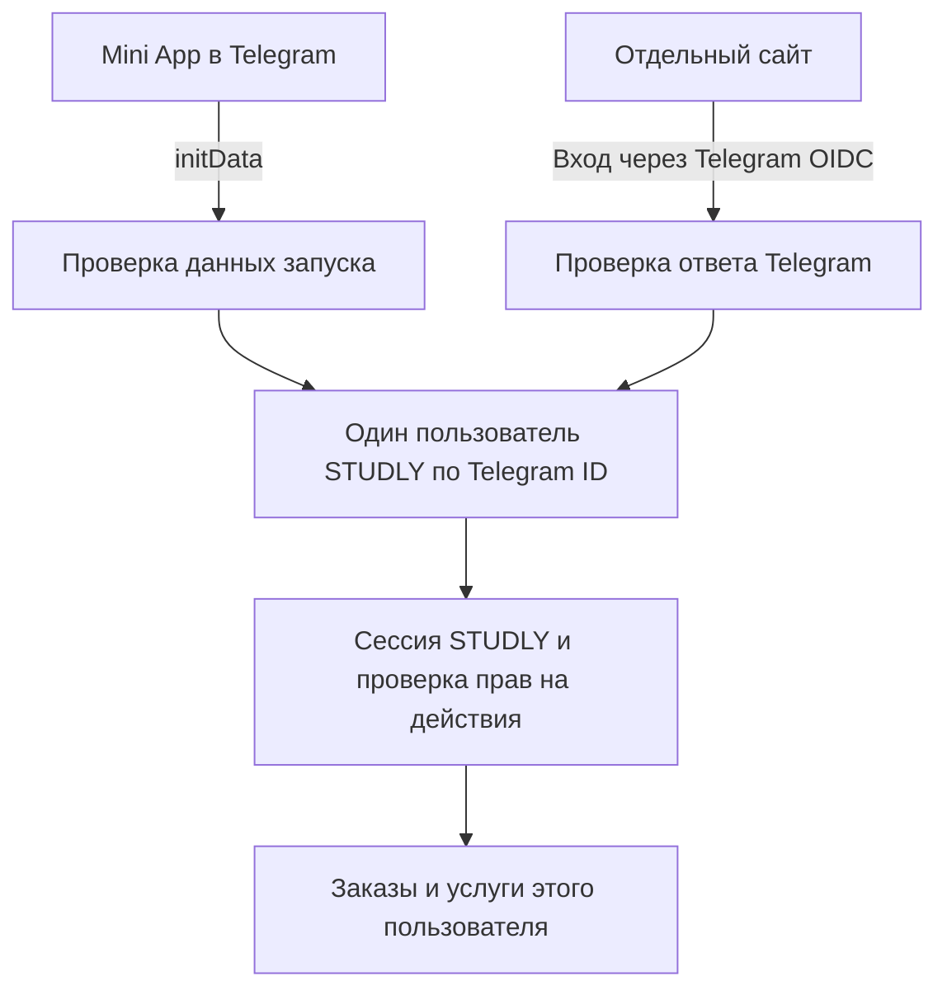

# STUDLY: вход через Telegram

Текущий статус после синхронизации 15 октября 2026 года: серверная авторизация сохранена, но прежние клиентские компоненты интеграции убраны. Актуальный Frontend друга (`origin/main`, `ccfde59`) пока не подключён к маршрутам входа/сессии. За клиентское подключение отвечает его разработчик. Нижеприведённые результаты прежней интеграции относятся к истории. Актуальные границы: [RUN_LOCAL.md](RUN_LOCAL.md).

Дата: 15 октября 2026 года. Требования и реализация серверной части согласованы пользователем. Модель пользователя, PostgreSQL и обработчики обоих способов входа реализованы и проверены автоматическими тестами. Бот создан, токен подтверждён Telegram и подключён к Backend. Локальный Frontend подключён к маршрутам сессии; настройка HTTPS, OIDC Client Secret и проверка настоящего входа ещё не завершены: [текущее состояние](TELEGRAM_SETUP.md).

## Что подтверждено

- STUDLY должен работать и внутри Telegram как Mini App, и как отдельный сайт с входом через Telegram.
- Один аккаунт может заказывать услуги и выступать исполнителем.
- Основа Backend уже согласована: Python, Django, Django REST Framework, PostgreSQL.

Это требования из обсуждения с владельцем проекта. Общий аккаунт описан в [модели пользователя](apps/api/accounts/models.py), обработчики входа — в [accounts/views.py](apps/api/accounts/views.py). Исходное состояние интерфейса описано в [диагностике](DIAGNOSTICS.md). Теперь локальный Frontend подключён к каталогу и маршрутам сессии; настоящий вход ещё требует внешних настроек. Текущее состояние: [RUN_LOCAL.md](RUN_LOCAL.md).

## Общая схема

Предлагается один аккаунт STUDLY и два способа подтвердить принадлежность Telegram-аккаунта. Telegram отвечает на вопрос «кто вошёл». Django находит пользователя в нашей базе, создаёт сессию STUDLY и проверяет права при дальнейших действиях.

**В Mini App:** интерфейс передаёт Backend исходную строку `Telegram.WebApp.initData`. Backend проверяет HMAC с токеном своего бота и свежесть `auth_date`; `initDataUnsafe` не является доказательством входа. Доверять полям пользователя можно только после проверки. Официальный источник: [Telegram Mini Apps: validation](https://core.telegram.org/bots/webapps#validating-data-received-via-the-mini-app).

**На отдельном сайте:** предлагается Telegram OpenID Connect, Authorization Code Flow с PKCE. Backend обрабатывает возврат после входа, проверяет `state`, обменивает код и проверяет подпись ID token, `iss`, `aud`, `exp` и выданный им `nonce`. Предлагаемые разрешения — `openid profile`. Источник: [Telegram Login](https://core.telegram.org/bots/telegram-login).

Бот представляет STUDLY в Telegram. Для проверки запуска Mini App не нужен отдельный сервис обработки сообщений. Пользователь продолжает работать с нашим HTTP API.

## Как сохранять один аккаунт

Предлагается собственная модель пользователя Django с внутренним ID STUDLY. Этот ID связывает пользователя с услугами и заказами; способ входа не определяет идентификаторы бизнес-данных. Собственную модель следует задать до первых миграций: [рекомендация Django](https://docs.djangoproject.com/en/5.2/topics/auth/customizing/#using-a-custom-user-model-when-starting-a-project).

Минимальный набор данных для обсуждаемого входа:

| Данные | Назначение |
|---|---|
| Внутренний ID STUDLY | Связи внутри нашей БД |
| `telegram_id`, уникальное 64-битное целое | Сопоставление подтверждённых входов из Mini App и сайта |
| OIDC `sub` с учётом доверенного `issuer` | Идентификатор входа OIDC; сохраняется при первом входе с сайта |
| Отображаемое имя, необязательный Telegram username | Показ профиля; не доказательство личности |
| Признак активности и административные права Django | Возможность блокировать доступ и отдельно управлять служебными правами |

В OIDC поле `sub` нельзя приравнивать к Telegram ID: подтверждённый Telegram ID передаётся в поле `id` при разрешении `profile`. В Mini App используется проверенное `user.id`. Источник структуры ответа: [Telegram Login: user data](https://core.telegram.org/bots/telegram-login#user-data-structure).

Предлагаемый алгоритм после проверки Telegram: найти запись по Telegram ID, при отсутствии создать её; при входе OIDC сохранить и сверить связь с его идентификатором. Изменение username не создаёт нового пользователя. Конфликт уже сохранённых связей отклоняется, а не запускает автоматическое объединение разных аккаунтов. Уникальность Telegram ID обеспечивает БД, включая одновременные первые входы.

Публичная регистрация по паролю в этот этап не входит. Не следует автоматически объединять Telegram-аккаунты по имени, username или данным, которые прислал непроверенный клиент. Исторические демонстрационные профили Frontend также не получают владельцев автоматически.

## Заказчик и исполнитель

В модели не предлагается взаимоисключающее поле `role = customer | performer`. Отношение определяется конкретным объектом: у заказа есть заказчик, у услуги — её исполнитель. Один пользователь может участвовать в обоих сценариях.

Это ещё не определяет, кто может публиковать услуги, как проходит проверка исполнителя и какие переходы статусов заказа разрешены. Эти бизнес-правила пока не подтверждены. Администратор и модератор — отдельные полномочия; вход через Telegram не выдаёт их автоматически.

## Сессия после входа

Доказательство входа Telegram обменивается на собственную сессию STUDLY. Она связывает последующие API-запросы с пользователем и прекращает работать после выхода или блокировки согласно серверным проверкам. Пароль Telegram серверу STUDLY не передаётся.

Для сайта предлагается начать со стандартной серверной сессии Django: защищённая cookie `HttpOnly`, HTTPS и CSRF-защита запросов, меняющих данные. Источник механизма: [Django sessions](https://docs.djangoproject.com/en/5.2/topics/http/sessions/).

Окончательно фиксировать передачу сессии для обоих клиентов следует после выбора доменов и проверки Telegram Web: там Mini App может работать во встроенном контексте с ограничениями браузера на cookie. Это пункт проверки совместимости, а не основание обещать, что одна настройка cookie уже покрывает все клиенты. До этого теста отдельный JWT-механизм и место хранения токенов не выбираются. `initData` не используется вместо сессии во всех запросах.

## Реализованные серверные маршруты

Маршруты зарегистрированы в [accounts/urls.py](apps/api/accounts/urls.py). При отсутствии параметров соответствующий вход возвращает `503`. Сейчас токен Mini App загружен, а OIDC ожидает отдельные параметры из BotFather. Инструкция и точные форматы: [README Backend](apps/api/README.md).

| Маршрут | Назначение |
|---|---|
| `GET /api/v1/auth/csrf/` | Получить CSRF-токен для POST входа и выхода |
| `POST /api/v1/auth/telegram/mini-app/` | Проверить `initData`, найти/создать пользователя и начать сессию |
| `GET /api/v1/auth/telegram/start/` | Начать вход на сайте через OIDC |
| `GET /api/v1/auth/telegram/callback/` | Обработать ответ OIDC и начать сессию |
| `GET /api/v1/auth/me/` | Вернуть профиль текущего пользователя STUDLY |
| `POST /api/v1/auth/logout/` | Завершить текущую сессию |

## Порядок реализации и проверки

1. Задать пользовательскую модель и ограничения уникальности, подключить PostgreSQL, создать первые миграции. Проверить создание записей и сопоставление одного Telegram ID с одним пользователем.
2. Реализовать проверку Mini App. Тестами покрыть корректные данные, подмену полей, неверную подпись, отсутствие обязательных полей, слишком старую и недопустимо будущую дату. Допустимый возраст и погрешность времени задаются настройками проекта.
3. Подключить OIDC через поддерживаемую библиотеку; отдельно проверить её совместимость с Telegram. Тесты должны отклонять неверные `state`/`nonce`, подпись, адрес издателя, получателя и истёкший token. При недоступности проверки вход завершается ошибкой, без обхода проверки.
4. Добавить сессию, текущий профиль и выход. Проверить, что оба способа входа дают один ID STUDLY, разные Telegram ID — разные записи, конфликт связей и блокировка отклоняют вход. Проверить ограничения чужого доступа и завершение сессии.
5. После разрешения на изменение Frontend подключить оба входа и проверить их в браузере и целевых клиентах Telegram. Одна успешная проверка Backend не подтверждает совместимость всех этих клиентов.

Для реальной интеграции понадобятся адрес Mini App по HTTPS, адрес сайта и зарегистрированный callback. Бот STUDLY уже создан и проверен через `getMe`. В настройках BotFather для OIDC выдаются Client ID и Client Secret; токен бота и Client Secret хранятся только на сервере. Источник настройки: [Telegram Login: Allowed URLs](https://core.telegram.org/bots/telegram-login#registering-your-allowed-urls). Публичного адреса пока нет; владелец подтвердил, что проект запускается только локально. Секреты не нужно отправлять в чат или добавлять в исходники.

До публикации также нужно определить сценарий потери доступа к Telegram. Возможность привязать другой аккаунт или восстановить доступ без Telegram сейчас не согласована и не обещается пользователю.

## Результат реализации

Созданы приложение `accounts`, начальная миграция и локальная PostgreSQL через [Compose](compose.yaml). Реализованы проверка HMAC и срока Mini App, OIDC через Authlib с PKCE, state и nonce, общая привязка пользователя, серверная сессия, CSRF-защита входа и выхода. При конфликте привязок или блокировке вход отклоняется. Текущие сроки проверки: 300 секунд для Mini App и попытки OIDC, 30 секунд допустимой погрешности часов; значения настраиваются окружением.

Автоматические проверки в [accounts/tests.py](apps/api/accounts/tests.py) проверяют криптографические подписи тестовыми ключами и реальное хранение в отдельной тестовой PostgreSQL. Они не подтверждают настройку реального бота. Бот уже создан; остаются регистрация адресов, параметры OIDC и проверка совместимости с целевыми клиентами Telegram.

Итоговая проверка: 33 теста прошли; системная проверка Django и зависимости без замечаний, незаписанных изменений моделей нет. На запущенном локальном сервере HTTP-запросы подтвердили `200` для `health`, `403` для профиля без входа и `503 telegram_not_configured` для обоих способов входа до настройки бота. POST Mini App проверен с полученной CSRF-cookie и токеном. Тестовые аккаунты в рабочую БД не добавлялись.

После получения токена бота официальный Telegram API подтвердил подключение. Backend перезапущен: теперь поддельные данные Mini App отклоняются с `401`, а OIDC по-прежнему возвращает `503` до заполнения остальных параметров. Подробности в [TELEGRAM_SETUP.md](TELEGRAM_SETUP.md).

При интеграции каталога добавлены публичные описание пользователя и демонстрационные исполнители с пустым Telegram ID, непригодным паролем и отключённым входом. Проверенный вход по-прежнему требует положительный Telegram ID; демонстрационный профиль не связывается с настоящим аккаунтом по имени. `/auth/options/` сообщает Frontend только готовность способов входа. Прежний компонент AuthPanel с чтением сессии, CSRF и выходом теперь хранится только в резервной копии и не входит в актуальный Frontend друга. Выполненные ранее браузерные проверки прокси не подтверждают текущую интеграцию. Успешный вход с настоящим Telegram ещё не проверен. OIDC callback пока отвечает JSON, переход обратно в интерфейс предстоит завершить при настройке настоящего входа.
