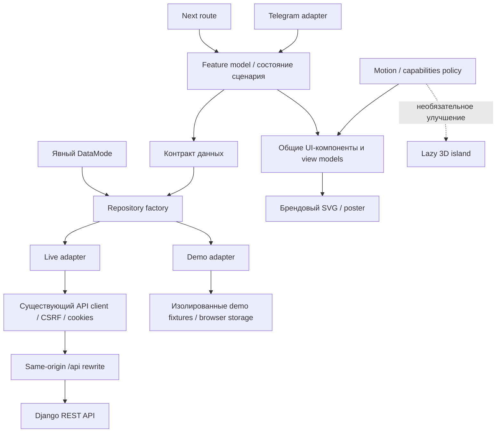

# STUDLY Redesign 2.0 — рекомендуемый стек и архитектура

- Начало: **17.10.2026, 22:53 Europe/Moscow**; продолжение после перерыва: **18.10.2026, 01:34:05 Europe/Moscow**. Окончание записи и проверки: **18.10.2026, 01:42:03 Europe/Moscow**, системные часы.
- Статус: **ADR-предложение для согласования, без установки зависимостей и изменения приложения**.
- Git: `codex/frontend-registration` / `24117052e6091efb391c8840e3d98b2708b773c3`; интеграция `7a50ea4`, регистрация `893a6fd`, база `ccfde59`. После безопасного fetch Frontend remote совпадает с HEAD; Backend remote — `d7a5ffa5abc1537301ced7275da9e45282d6b4f3`.
- Источники: [проверка технологий и версий](2026-10-17_22-53_technology-research.md), [аудит](2026-10-17_22-53_frontend-audit.md), [концепции](2026-10-17_22-53_design-concept-proposals.md), [Backend-контракт](https://github.com/lex44lh/Studly/blob/d7a5ffa5abc1537301ced7275da9e45282d6b4f3/REGISTRATION_API.md), `apps/web/INTEGRATION.md`, `apps/web/src/lib/api/*`, `next.config.ts` и локальный lockfile.

## 1. Единственный основной выбор

**A: Next.js + React + TypeScript + CSS/CSS Modules + Motion for React.** Существующий Django REST API остаётся единственным Backend. Для базового редизайна **не устанавливать Three.js, R3F, GSAP, Babylon и WebGPU-обвязки**.

CSS отвечает за тему, layout, hover/focus/press и простые transitions. Motion — за управляемое появление sheet/dialog, ограниченные layout-переходы и фирменную SVG-ленту. Одна система анимационных токенов, один владелец каждой анимируемой transform. GSAP и Motion не дублируют друг друга.

Three.js подходит STUDLY **локально**, если одна брендовая сцена действительно улучшит первый контакт. R3F будет разумным React-адаптером именно такой сцены, если она будет отдельно утверждена и пройдёт mobile-пилот. Это последующая необязательная возможность, а не второе обязательное ядро. Для выбранного направления полноценная 3D не требуется.

Менять Next.js ради WebGPU нет причин: renderer работает в client island, независимо от того, как Next маршрутизирует и доставляет DOM. Миграция на другой framework сейчас добавила бы риск контрактам, авторизации и маршрутам без доказанного выигрыша.

## 2. Версионная политика

| Слой | Проверено в рабочем проекте | Кандидат после согласования | Решение |
|---|---|---|---|
| Next.js | 16.3.4 | 16.4.2, после проверки официального security advisory и regression suite | Отдельный небольшой patch/minor этап; не смешивать с визуальной заменой |
| React / React DOM | 19.2.8 / 19.2.8 | Согласованная пара 19.3.1 / 19.3.1 | Проверить peers Next и тесты; наличие свежей версии не доказывает совместимость приложения |
| TypeScript | 5.9.3 в lockfile, диапазон `^5` в manifest | Сначала оставить 5.9.3 | Не прыгать на 7.0.2: текущие инструменты lint имеют более узкий peer range |
| Tailwind | 4.3.3 в lockfile | Сохранить имеющуюся зависимость | Новые семантические токены и CSS Modules; не мигрировать все стили ради синтаксиса |
| Motion | Не установлен | 14.3.0, exact pin после pilot | Проверить peerDependencies, tree shaking, Reduced Motion, client boundary и production bundle |
| Three / R3F | Не установлены | Только если отдельно разрешён 3D pilot: Three 0.186.1 + R3F 9.8.2 | Это кандидатная комбинация по published peers; app-level совместимость ещё не проверялась |

Версии и статусы проверены по первичным источникам в Technology Research; таблица не означает, что candidate build уже запускался. На этапе аудита зависимости не обновлялись. [Официальное уведомление Next от 14.10.2026](https://nextjs.org/blog/nextjs-security-update-october-14-2026) требует исправленных релизов; локальные `next 16.3.4` и `sharp 0.35.4` требуют отдельной проверки перед следующим Live-релизом. Факт опубликованного advisory не доказывает эксплуатацию STUDLY.

## 3. Сравнение вариантов

| Вариант | Что получает STUDLY | Сильные стороны | Цена внедрения и ограничения | Роль |
|---|---|---|---|---|
| **A. Next + React + TS + Motion** | DOM-продукт, хорошие переходы и микроинтеракции | Удобный React lifecycle, небольшой объём нового инструментария, простой static fallback | Не заменяет 3D engine; плохую композицию не исправляет | **Основной выбор** |
| B. Next + React + TS + Motion + R3F + Three | A плюс отдельная настоящая 3D-сцена | Декларативная композиция, scene lifecycle внутри React, возможность WebGL | Дополнительный chunk, GPU/asset pipeline, context loss и тесты; R3F не делает тяжёлую сцену автоматически быстрой | Только будущий branded pilot |
| C. Next + React + TS + GSAP + Three | Сложные связанные timeline/camera/scroll сцены | Точный creative control, сильные timeline/ScrollTrigger инструменты | Больше imperative lifecycle и cleanup в React; scroll choreography не является основным сценарием STUDLY | Не выбран |
| D. Next + React + TS + CSS/WAAPI без animation library | Нативные transitions и минимальные эффекты | Минимум зависимости, хороший fallback, достаточно для большей части форм | Presence/layout/spring orchestration пришлось бы писать и поддерживать вручную | Хорошая резервная стратегия, но A лучше для общей библиотеки интеракций |

Альтернатива D сохраняет основной framework. Babylon.js хорош для сложных real-time сцен/игровых задач, но не решает уникальной потребности каталога, не сокращает миграцию и добавляет ещё один scene framework. Svelte/Vue/Vite не предлагаются как путь редизайна: доказательств необходимости переписать React/Django-интеграцию нет. Для иллюстраций часто выгоднее SVG/CSS или заранее отрендеренный постер; canvas оправдывается только полезной интерактивностью.

### Взвешенная модель выбора

Вес задаётся задачами Telegram-маркетплейса, а не престижем технологии. Шкала 1–5 означает пригодность **предложенного варианта реализации**, не качество библиотеки вообще. Измерений пользовательской конверсии и будущего bundle для новых стеков пока нет.

| Критерий | Вес | A | B | C | D |
|---|---:|---:|---:|---:|---:|
| UX и понятность ежедневных действий | 24% | 5 | 5 | 4 | 5 |
| Качество требуемых визуальных эффектов | 12% | 4 | 5 | 5 | 3 |
| Производительность/стоимость enhancement | 17% | 5 | 4 | 4 | 5 |
| Telegram-совместимость и объём QA | 16% | 5 | 4 | 4 | 5 |
| Надёжность/fallback | 12% | 5 | 4 | 4 | 5 |
| Поддерживаемость React-командой | 10% | 5 | 4 | 3 | 4 |
| Простота внедрения в текущий проект | 5% | 5 | 3 | 3 | 5 |
| Масштабирование разделов | 4% | 4 | 4 | 4 | 4 |
| **Взвешенный итог / 5** | **100%** | **4.84** | **4.31** | **3.97** | **4.62** |

Формула: сумма `(оценка × вес) / 100`. UX, скорость и Telegram занимают 57%: это основная среда и задачи аудитории. Эффекты получают 12%, чтобы оригинальность учитывалась, но не побеждала за счёт количества 3D. Сложность внедрения — 5%, поскольку временные затраты не должны перекрывать долгосрочное качество.

B оценивается с lazy 3D, а не с canvas на каждой странице. Даже при lazy остаются отдельные GPU-тесты и аварийные состояния. Если эксперимент докажет полезность и не ухудшит бюджеты, его можно добавить к A локально. В чувствительности к весам: повышение веса графики может сблизить A/B, но менять приоритеты ежедневного маркетплейса ради победы B было бы неверно. Эти числа — прозрачная инженерная аргументация, не объективный рейтинг рынка.

## 4. B: WebGL против WebGPU

| Аспект | WebGL как базовый renderer | WebGPU с fallback |
|---|---|---|
| Практический выбор для одной сцены STUDLY | Наиболее разумный первый pilot, WebGL2 capability проверяется | Не основной путь; допускается последующий контролируемый эксперимент |
| Доступность | Широкая, но context может быть отключён/потерян и WebGL2 не гарантирован | Наличие API не гарантирует adapter/device; зависит от ОС, WebView, GPU, драйвера и Telegram-клиента |
| Three pipeline | Обычный WebGLRenderer, совместимые материалы | WebGPURenderer/TSL, асинхронная инициализация, отдельная проверка материалов/постэффектов |
| Fallback | Static poster/SVG, отсутствие canvas не блокирует DOM | Если поддерживается выбранной Three-версией — её WebGL backend; при несовместимых эффектах отдельная простая WebGL-сцена, затем static |
| Важно | Three WebGLRenderer и WebGPU→WebGL backend не считать одним и тем же renderer | RawShaderMaterial/onBeforeCompile/сторонние GLSL-пакеты не считать автоматически переносимыми на TSL |
| Next | Lazy client island, cleanup и error boundary | То же, плюс async initialization и device loss |
| Статус | Предсказуемее для этого небольшого использования | Доступность и инструменты улучшаются, но проверка каждого runtime-пути остаётся обязательной |
| Вывод | Если реальная 3D понадобится — начать здесь | Для текущих требований выгода не компенсирует дополнительную сложность |

WebGPU fallback у renderer не означает, что любая сцена, shader и зависимость имеют одинаковое изображение на обоих backend. R3F stable 9.x для React 19 следует рассматривать отдельно от 10 alpha. Смешивать stable Three/R3F с alpha-адаптером ради нового renderer не рекомендуется.

## 5. Будущие модули — без массового переезда файлов

```text
apps/web/src/
  app/                          существующие URL, thin page composition
  providers/                    AppProviders: auth, режим, Telegram, ресурсы
  shared/
    ui/                         Button, Field, Sheet, Dialog, Tabs, Card, ApiState
    design/                     semantic tokens, typography, themes, density
    motion/                     durations, easing, reduced-motion policy
    platform/telegram/          адаптер SDK, safe areas, viewport, lifecycle
    platform/capabilities/      feature detection и политика enhancement
    api/                        существующий transport/CSRF/error model
  entities/
    service/ performer/ order/  DTO mapping, view models, базовые карточки
  features/
    auth/ registration/ search/ favorites/ publish-service/ orders/ chat/
      model/                    состояния/сценарии, независимо от раскладки
      ui/                       общие формы и представления
  data/
    contracts/                  стабильные интерфейсы потребностей UI
    live/                       адаптеры существующего Django API
    demo/                       fixtures и безопасные локальные сценарии
    create-repositories.ts      выбор ровно одного режима при старте
  brand/
    illustrations/              SVG/poster, доступны без GPU
    scenes/                     будущие isolated client islands; пусто до pilot
```

Это границы ответственности, не приказ создать десятки пустых папок. Переносить по одному feature вместе с его новой страницей. Существующие DTO/client не переписывать ради расположения: сначала вынести адаптер поверх них. Не создавать Next API routes вместо Django.



**Зависимости:** shared UI не импортирует repository, AuthContext или Three. Scene не управляет навигацией, авторизацией и заказом. DTO не становится компонентным prop целиком: mapper явно определяет цену, срок, доступность и отсутствие рейтинга. Импорты Three не попадают в общий barrel `shared/ui`.

## 6. Demo/Live без двойного интерфейса

Текущий механизм выбирает режим через `NEXT_PUBLIC_STUDLY_DATA_MODE` при запуске `next dev` либо при **production `next build`**; это не переключатель пользователя после загрузки. В production значение вшито в клиентский bundle: смена переменной только у `next start` его не переключает, нужна пересборка. По умолчанию Live, на ошибке режима/сервера Demo не включается. Такую явность сохранить. Для демонстрации разумнее отдельный build/origin с постоянной маркировкой, чем runtime-тумблер поверх настоящей сессии.

| Правило | Demo | Live |
|---|---|---|
| Данные | Фикстуры, детерминированные сценарии | Ответы Django с настоящими IDs/status |
| Регистрация | Локальный preview; не обещает создание реального аккаунта | Сессия/CSRF, серверный draft, complete только по серверному ответу |
| Заказ | Явная демонстрационная запись без денег | Только реально поддержанная операция API |
| Платёж | Недоступен | Только при наличии согласованного и проверенного контракта |
| Неудачный запрос | Демонстрация отдельного error-сценария по выбору теста | Честный error/retry; никогда фикстуры вместо ответа |
| Избранное/черновики | Отдельный namespace | Текущий browser-only Live favorites; не изображать серверную синхронизацию |
| Видимость режима | Постоянный заметный badge в shell, Welcome и формах | При необходимости environment label; статус API отдельно от режима |

Один `ServiceCard` получает view model, один экран поиска — состояние feature и возможности данных. Различия сосредоточены в repositories/commands, а не в двух копиях страниц. Auth — отдельный сценарий: Demo не вызывает Mini App login/registration. Client capability matrix говорит `available/unavailable`, не выдумывает данные.

Не вводить универсальный «mock fallback» в transport. Не retry-ить POST/PATCH автоматически без согласованной идемпотентности. После logout/смены аккаунта очищать in-memory ресурсы и приватные view models, не смешивать чужие черновики; политику сохранения локального пользовательского содержимого согласовать отдельно.

**Известный конфликт:** прежний deployment plan использует `mode=api`, текущий незакоммиченный resolver принимает `demo/live`. До следующей публикации владельцы должны согласовать `live` в конфигурации деплоя или явную документированную совместимость. В этом исследовании файлы Backend и deployment не изменялись.

## 7. UI, ресурсы и ошибки

- Установить единый `ResourceState`: idle/loading/success-empty/success-data/error/unauthorized/unsupported. Не сводить пустой каталог и API 503 к одинаковой пустой карточке.
- Ошибки 401, 403/CSRF, 404, 409, 429, validation 400, timeout/offline и 5xx получают разные действия; пользовательский текст не содержит stack trace или initData. Корреляционный ID показывать только если сервер его уже отдаёт.
- URL хранит query, подтверждённые фильтры, sort и страницу, если они действительно поддержаны контрактом. Debounce запросов и AbortController снижают гонки; client-фильтрация одной страницы не изображает фильтрацию всего каталога.
- Не добавлять TanStack Query/Zustand автоматически. Сначала использовать малые feature hooks поверх существующего client; если появится доказанная потребность в общих cache/invalidation/retry — отдельный ADR с измерением новой зависимости.
- Публичные/статичные оболочки могут оставаться Server Components; Telegram/auth, локальные формы и динамические данные изолируются в client boundaries. Персональные ответы не кешируются как общедоступный HTML.
- Провайдер Telegram оборачивает доступ к SDK и подпискам; каждая подписка имеет cleanup. `initDataUnsafe` — только необязательная подсказка, аутентификация — raw initData через Django.

## 8. Тестируемость и сохранение контрактов

Сохранить URL и trailing slash API, credentials/CSRF, wire names, decimal money и server-owned final state. Новая разметка не меняет контракт регистрации. Demo/live adapters проходят одинаковые shape-тесты view models, но Demo не считается проверкой Django.

Проверки по уровням: существующие 21 unit/contract тест; новые тесты только на новую логику/гонки; component interaction для focus, forms и sheet; Playwright journeys с явно маркированными fixtures; отдельный staging E2E на настоящем Django; manual Telegram iOS/Android и weak device. Визуальные snapshots — для стабильных компонентов/состояний, не для каждого декоративного CSS-изменения.

Флаги миграции включают новый UI **для одного маршрута**, а не другой источник данных. Откат возвращает старое представление с тем же repository/API; flags визуального rollout не должны переводить Live в Demo.

## 9. Факты, допущения и вывод

**Факты:** текущий Next/React/TS проект собирается, содержит реальные Django adapters, Demo/Live уже разделяются явно, 3D-зависимостей нет. Релизная совместимость candidate stack в STUDLY не проверена установкой. **Предположения:** Motion достаточно для выбранной концепции; одна сцена может повысить узнаваемость, но это не измерено.

**Решение для утверждения:** стек A и концепция «Кампус». Сначала API/config baseline, дизайн-токены и вертикальный сценарий поиск → услуга. Затем остальные разделы. Three/R3F/WebGPU не являются условием начала или завершения редизайна.
