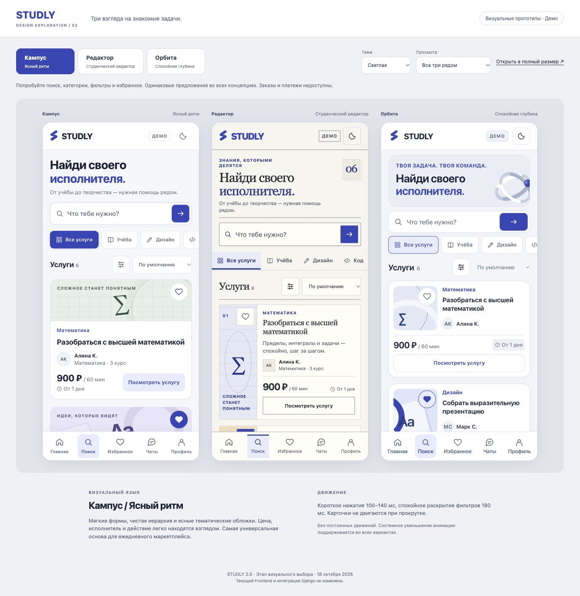
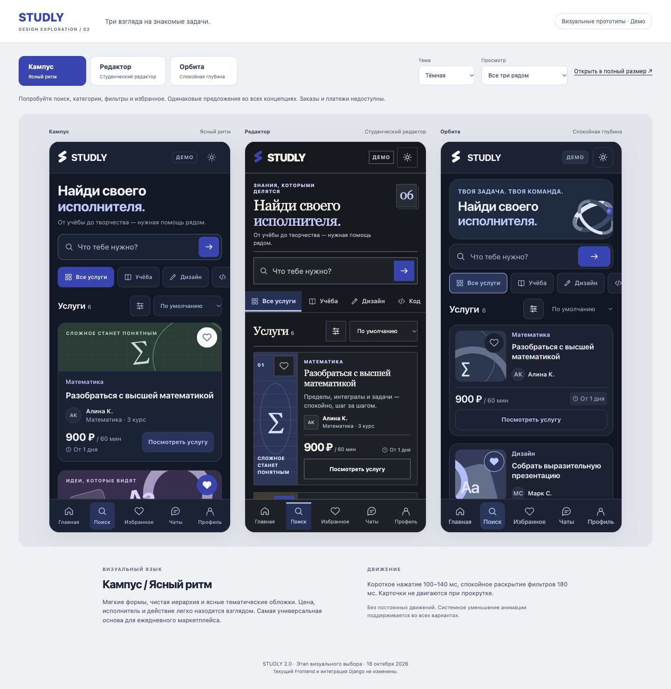
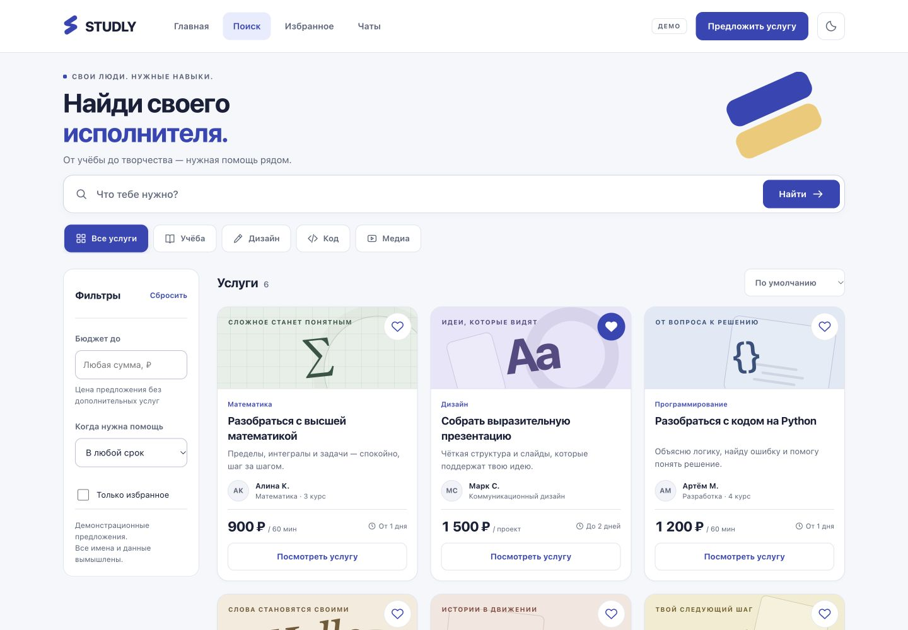
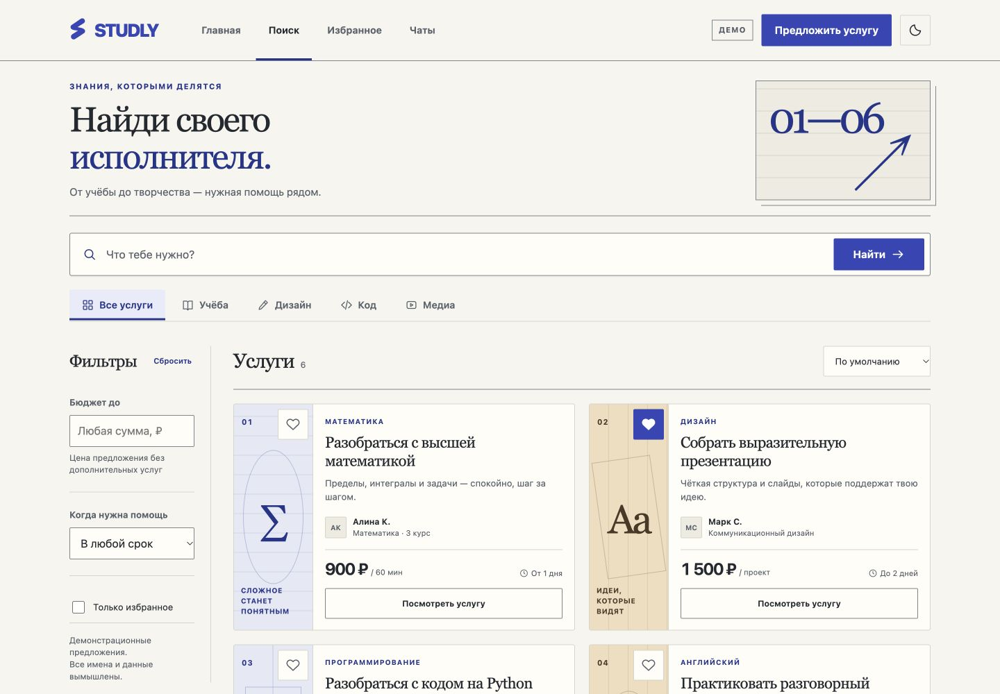
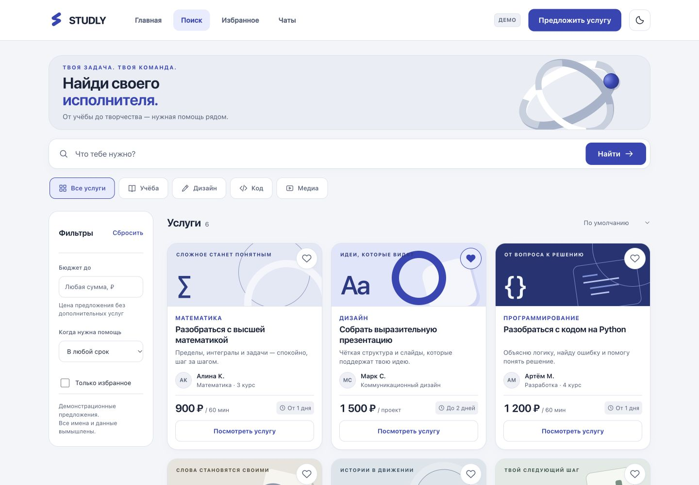

# STUDLY Redesign 2.0 — этап2: визуальные прототипы /search

- Начало: **18.10.2026, 02:08:59 Europe/Moscow** (системные часы:17.10.2026 23:08:59UTC).
- Контрольное время завершения проверок: **18.10.2026, 02:22:51 Europe/Moscow**; итоговая запись времени — в конце.
- Продолжение финального оформления после паузы: **18.10.2026, 13:07:30 Europe/Moscow**, системные часы. Проверки размеров и сценариев выше относятся к ночному сеансу; сохранность исходников и ссылки повторно проверены после продолжения.
- Статус: **три интерактивных визуальных направления подготовлены; окончательный дизайн не утверждён; рабочее приложение не перерабатывалось**.
- Технологическое направление предварительно согласовано пользователем: Next.js + React + TypeScript + CSS + Motion. Для изолированных макетов использованы обычные HTML/CSS/JS без установки библиотек. CSS демонстрирует motion language; production Motion-интеграция не выдаётся за выполненную.
- Git: `codex/frontend-registration`, HEAD `24117052e6091efb391c8840e3d98b2708b773c3`; прежние tracked/untracked изменения сохранены. Backend reference предыдущего аудита — `d7a5ffa5abc1537301ced7275da9e45282d6b4f3`, [контракт](https://github.com/lex44lh/Studly/blob/d7a5ffa5abc1537301ced7275da9e45282d6b4f3/API_CONTRACT.md). Новых коммитов нет.

## 1. Что подготовлено и как сравнивать

**[Открыть единый файл сравнения](prototypes/2026-10-18-search/dist/studly-concepts.html)**. Он содержит три варианта и все необходимые CSS/JS. В просмотрщике доступны: выбор направления, светлая/тёмная/системная тема, мобильный экран390px, desktop1440px, три мобильных экрана рядом, отдельная карточка и пять состояний кнопки. «Открыть в полный размер» создаёт локальный документ выбранного варианта в новой вкладке.

Прототипы проверены через временный локальный HTTP-сервер. Прямой `file:`-просмотр браузерный инструмент отклонил из-за разрешённых протоколов, поэтому автономное открытие на разных обычных браузерах не считается проверенным. [Инструкция повторного локального просмотра](prototypes/2026-10-18-search/README.md) не требует установки зависимостей.

**Светлая тема — слева направо: Кампус, Редактор, Орбита.**

**Тёмная тема — тот же порядок, те же данные.**

Изображения — реальные снимки браузера с работающих HTML-прототипов. Это не текст, объявленный макетом, и не AI-картинка с несуществующими контролами.

## 2. Безопасная изоляция

До реализации предложен пользователю способ: отдельная папка прототипов со своими вымышленными данными, без вмешательства в `apps/web`. Созданы только файлы `frontend/redesign/prototypes/2026-10-18-search/`, настоящий отчёт и ссылки в индексах.

- Backend, текущие страницы/компоненты, API-контракты, `.env`, root/package manifests, lockfile и Demo/Live не изменялись.
- 85 tracked файлов приложения/конфигурации сохранены по SHA-256 snapshot; повторная проверка показала0изменений. Прежний новый `data-mode.ts` не редактировался.
- Прототипы не импортируют текущий API client/data mode, не обращаются к Django/Telegram SDK, не используют localStorage, не регистрируют аккаунты и не создают заказы. Browser storage и настоящая сессия не затронуты.
- `connect-src 'none'` в CSP дополнительно запрещает программные сетевые соединения; assets только локальные/встроенные. Никаких Three/R3F/WebGPU/GSAP или remote fonts.
- Временный сервер ограничен `127.0.0.1:3118` и папкой `dist`. Публичная публикация не выполнялась. Использован Sites skill в локальном режиме, без регистрации Site и deployment.
- Merge, rebase, reset, commit и push не выполнялись. Брендовый архив не использовался и не публикуется.

## 3. Равные условия сравнения

Один `app.js` создаёт все три страницы. Одинаковы: поисковый запрос, пять категорий, бюджет, срок, сортировка, избранное, окно услуги, пустая выдача, подписи основных действий, набор данных и цены. Общий заголовок «Найди своего исполнителя» исключает сравнение разных предложений продукта вместо дизайна.

Шесть фикстур: математика900₽/60мин, презентация1500₽/проект, Python1200₽/60мин, английский800₽/45мин, видео1800₽/ролик, резюме700₽/разбор. Имена вымышлены. Нет фиктивных рейтингов, отзывов, значков проверки или количества выполненных заказов.

Навигация имеет верхний desktop и нижний mobile варианты с теми же подписями. Соседние разделы представлены как пример навигации: кнопка честно сообщает, что сейчас открыт прототип поиска. Заказ/оплата disabled, публикация не изображает успех. После reload сбрасывается только память прототипа.

В «Кампусе» и «Орбите» часть описания на mobile перенесена в окно услуги, чтобы цена/действие были видимы. В «Редакторе» описание остаётся в карточке. Доступный пользователю объём информации одинаков, плотность выдачи разная — это осознанное различие композиции.

## 4. Кампус / Ясный ритм

**Идея:** дружелюбный современный marketplace без визуального шума. Светлые поверхности, ясные смысловые группы, скругления, спокойные предметные CSS-обложки. Синий #3547B8 — действия и активные состояния; тёплый акцент используется только в иллюстрации.

- Типографика: системный sans с кириллицей, уверенные заголовки и крупная цена. Шрифты из сети не требуются.
- Desktop: три колонки, понятный фильтр слева, привычная верхняя навигация.
- Mobile: одноколоночная выдача, обложка104px, цена и CTA в одной нижней строке; основные сведения об исполнителе остаются видны.
- Карточка: тонкая граница, мягкие радиусы, тематический акцент. Разделение фото/описания/исполнителя/цены считывается без обучения.
- Motion: короткие реакции140ms, ограниченное смещение, окно фильтров180ms; нет анимации каждого элемента списка или декоративного цикла.
- Преимущества: наиболее универсален для новых разделов, обычных студентов и повторных сессий; спокойный фон помогает пользовательскому контенту.
- Недостатки/риск: без качественной типографики и собственной графики может выглядеть типовым; иллюстрации нужно развивать как систему, не набор случайных картинок.
- Telegram: простые непрозрачные поверхности,44pxконтролы, постоянная нижняя навигация, минимальный декоративный вес. На390px первая CTA заканчивается на669px при начале nav770px.

[Mobile light](prototypes/2026-10-18-search/screenshots/campus-mobile-light.jpg) · [Mobile dark](prototypes/2026-10-18-search/screenshots/campus-mobile-dark.jpg) · [Desktop light](prototypes/2026-10-18-search/screenshots/campus-desktop-light.jpg) · [Desktop dark](prototypes/2026-10-18-search/screenshots/campus-desktop-dark.jpg) · [Карточка и состояния](prototypes/2026-10-18-search/screenshots/campus-components.jpg)

## 5. Студенческий редактор

**Идея:** цифровое студенческое издание с реальными задачами. Бумажные оттенки, тонкие линии, прямые формы, наборные обложки, folio-номера и редакционная вертикаль.

- Типографика: Georgia/системный serif для заголовков, системный sans для форм, цен и вспомогательного текста. Принципиально иной характер, не просто перекрашенный «Кампус». Фактический serif fallback на Android ещё нужно проверить.
- Desktop: две колонки горизонтальных карточек, боковая типографическая обложка, более плотный поток информации.
- Mobile: узкая боковая обложка и текст справа, описание в выдаче, цена и кнопка внизу. Размеры растут по содержимому, текст не фиксируется в обрезанный прямоугольник.
- Motion: короткое подчёркивание/изменение границы140ms; sheet180ms. Никаких обязательных перелистываний страниц.
- Преимущества: самое выраженное редакционное лицо, хорошо поддерживает подборки и разные творческие услуги без GPU.
- Недостатки/риск: выше плотность, декоративная нумерация может восприниматься как рейтинг; в узкой колонке длинные названия занимают больше строк. Не стоит переносить folio-стиль на поля оплаты и юридические условия.
- Telegram: работает тем же DOM и безопасными областями. На390px первая CTA заканчивается727px при nav770px; на320px нужен дополнительный скролл. Это наблюдение layout, не измеренное замедление задач.

[Mobile light](prototypes/2026-10-18-search/screenshots/editorial-mobile-light.jpg) · [Mobile dark](prototypes/2026-10-18-search/screenshots/editorial-mobile-dark.jpg) · [Desktop light](prototypes/2026-10-18-search/screenshots/editorial-desktop-light.jpg) · [Desktop dark](prototypes/2026-10-18-search/screenshots/editorial-desktop-dark.jpg) · [Карточка и состояния](prototypes/2026-10-18-search/screenshots/editorial-components.jpg)

## 6. Орбита / Спокойная глубина

**Идея:** точная технологичная среда с прохладными поверхностями, геометрией и локальной глубиной. Серебристые кольца — небольшая декоративная CSS-иллюстрация. Существующий логотип остаётся отдельным неизменным знаком.

- Типографика: системный sans, точные отступы и спокойный контраст. В light — фарфоровые поверхности, в dark — сланцевые; тема не навязывается.
- Desktop: три колонки, глубина задаётся границами/поверхностями и иллюстрацией, без glass blur.
- Mobile: компактная обложка110px слева, имя/название справа, цена и CTA ниже на полную ширину. Дополнительное описание и специализация доступны в details.
- Motion: короткая реакция границы/поверхности140–160ms, window180ms. Ни вращения кольца, ни параллакса, ни camera fly-through в каталоге.
- Преимущества: наиболее технологичное впечатление; плотная mobile-карточка позволяет увидеть больше предложений; эффект глубины достигнут без графического движка.
- Недостатки/риск: стилистически ближе к fintech/AI-инструментам, может оказаться менее дружелюбным; нельзя расширять геометрию до постоянного шума на всех экранах.
- Telegram: тот же лёгкий DOM; реальная3D не требуется. На390px первая CTA заканчивается621px при nav770px. Это не доказательство лучшей конверсии, только другая плотность.

[Mobile light](prototypes/2026-10-18-search/screenshots/orbit-mobile-light.jpg) · [Mobile dark](prototypes/2026-10-18-search/screenshots/orbit-mobile-dark.jpg) · [Desktop light](prototypes/2026-10-18-search/screenshots/orbit-desktop-light.jpg) · [Desktop dark](prototypes/2026-10-18-search/screenshots/orbit-desktop-dark.jpg) · [Карточка и состояния](prototypes/2026-10-18-search/screenshots/orbit-components.jpg)

## 7. Проверки и измерения

Результаты сохранены в [qa-results.json](prototypes/2026-10-18-search/screenshots/qa-results.json). Проверялся реальный DOM/рендер в IAB. Для точных mobile-размеров использован собственный iframe390×844/320×780: попытка изменения размера основной вкладки в части сеанса сохраняла1440px; ошибочно помеченные промежуточные captures перезаписаны результатами с проверенным `documentElement.clientWidth`.

| Проверка | Фактический результат |
|---|---|
| 3концепции ×2темы mobile390×844 |6снимков, width=scrollWidth=390; все6карточек доступны в документе |
| 3концепции ×2темы desktop1440×1000 |6снимков, width=scrollWidth=1440; CTA первой строки905/891/911px соответственно |
| 320×780 dark |Все3:width=scrollWidth=320, доступные кнопки≥44px, вертикальный скролл сохраняется |
| Mobile390 CTA и нижняя навигация |669/727/621px <770px: цена и основное действие первой карточки видны |
| Safe area simulation24top/20bottom |Header92px, nav94px, workspace bottom padding120px; width390, overflow0 |
| Поиск Python |1результат в каждой концепции |
| Категория «Учёба» |3результата в каждой концепции |
| Бюджет≤1000 + срок1день |2результата в каждой концепции |
| Избранное |aria-pressed корректно меняется false→true в каждой концепции |
| Details/Escape |Открывается нужная услуга, заказ disabled, Escape закрывает окно |
| Пустой запрос результата/сброс |Empty state показан для отсутствующей услуги; после сброса6карточек |
| Размеры controls |В проверенных состояниях нет видимых кнопок уже44px или ниже44px; nav≥56px |
| CSS/JS syntax |7CSS разобраны PostCSS;3JS разобраны без синтаксических ошибок |
| Защита исходников |85SHA-256 совпали; `git diff --check` PASS; исходники не редактировались |

Контраст вычислен для выбранных13semantic пар: body/intro/category/title/performer/price/units/delivery/detail/selected category/demo/active nav. Среди видимых проверенных пар минимум: **Кампус5.56:1 light /7.41:1 dark; Редактор5.76/8.19; Орбита5.40/7.06**. Белый текст на основном синем —7.65:1. Это превышает4.5:1 для этих пар; не выдаётся за полный WCAG-аудит всех возможных изображений, псевдоэлементов и hover-state. Декоративная графика не содержит незаменимой информации.

Reduced Motion присутствует в общей и тематических CSS; отключает переходы/анимации, состояние показывается немедленно. Системная тема читает `prefers-color-scheme` и реагирует на его изменение; ручной выбор не перезаписывается системой. Настройки ОС пользователя в ходе работы не менялись. Safe area учитывается через `env` и отдельную тестовую симуляцию, без претензии на проверку Telegram bridge.

В инструментальном журнале IAB несколько раз зарегистрирована ошибка `MutationObserver.observe: parameter 1 is not of type Node`, без URL исходника/stack. Авторский код прототипов не использует `MutationObserver`; источник ошибки не установлен. Проверенные сценарии при этом выполнялись. Поэтому отсутствие runtime-ошибок во всех слоях браузерной среды не заявляется; ошибку нельзя приписать production STUDLY или считать доказанным дефектом его Frontend.

### Объём ресурсов

| Вариант | HTML+CSS+JS raw, bytes | Сумма локального gzip, bytes |
|---|---:|---:|
| Кампус |68007|17736|
| Редактор |62674|16556|
| Орбита |61426|16745|

Единый HTML213493bytes включает все3варианта. Размеры повторно сняты18.10 в13:09MSK после финальной корректировки якорных ссылок. Это файловые суммы и gzipSync, не фактическая сеть/HAR. Нет удалённых шрифтов/фото/движков. Прототип не содержит Next/React runtime, auth и настоящего API, поэтому сравнивать эти числа с production bundle как готовое ускорение нельзя.

**Не запускались:** физические iPhone/Android/Telegram, реальная клавиатура и системные safe areas, browser/OS matrix,200%text zoom, полноценный screen reader audit, реальные Django flows, RUM/CWV/FPS/память/батарея, usability со студентами. Непроверенное не объявляется выполненным.

## 8. Ответы для выбора

| Вопрос | Рекомендация и основание |
|---|---|
| Какая современнее? |**Орбита** выглядит наиболее технологично; **Кампус** — наиболее современно как повседневный продукт. «Новее» не означает полезнее; это художественная оценка, не тест аудитории. |
| Какая удобнее студентам? |**Кампус** — рекомендуемая гипотеза: ясная цена/имя/CTA, спокойный фон. **Орбита** выигрывает по плотности; выбор проверить задачами, а не голосованием за красивую картинку. |
| Какая лучше Telegram? |**Кампус** как безопасная базовая система. Все3прошли одинаковые проверки ширины/тем; реальные устройства пока не тестировались. |
| Какая легче масштабируется? |**Кампус**: простая система карточек/форм/состояний переносится на заказы, профиль и чат. Орбита технически сопоставима без3D, но требует дисциплины декоративного слоя. |
| Какая выразительнее? |**Редактор** — по типографике и собственной композиции; **Орбита** — по пространственному впечатлению. Качество не определяется количеством эффектов. |
| Что выбрать для STUDLY? |**Кампус / Ясный ритм** как основной UI. Сначала подтвердить первый экран и ServiceCard; отдельную бренд-сцену обсуждать позже, не делать её частью каталога. |

У всех3сейчас одинаковая функциональность. Суждения об удобстве — экспертные гипотезы по прототипам, не доказанное поведение российских студентов. Следующий разрешённый шаг после выбора — уточнить направление/проверить прототип, а не автоматически переписывать приложение.

## 9. Источники и связанные решения

Основа — все7документов предыдущего этапа:

1. [Frontend Audit](2026-10-17_22-53_frontend-audit.md): реальные маршруты, проблемные состояния и ограниченный API.
2. [Technology Research](2026-10-17_22-53_technology-research.md): DOM-first, CSS/Motion, никаких обязательных GPU APIs.
3. [Reference Analysis](2026-10-17_22-53_reference-analysis.md): визуальная дисциплина, один брендовый акцент, CSS-подходы и безопасные fallback.
4. [Design Concept Proposals](2026-10-17_22-53_design-concept-proposals.md): три направления и сохранение бренда.
5. [Recommended Tech Stack](2026-10-17_22-53_recommended-tech-stack.md): предварительно выбранный стекA, единые views.
6. [Redesign Roadmap](2026-10-17_22-53_redesign-roadmap.md): `/search` как первый вертикальный пилот.
7. [Risks and Compatibility](2026-10-17_22-53_risks-and-compatibility.md): темы, safe areas, Reduced Motion, честность измерений.

Логотип: `apps/web/src/components/BrandMark.tsx` и `public/studly-mark.svg`; исходный path/viewBox сохранён. Правила: корневой и Frontend AGENTS.md. Skills: Sites/local-only и local-preview reference; browser QA — CUA. Из внешних сервисов/аккаунтов данные не брались. Связанные исторические commits: `ccfde59`, `893a6fd`, `7a50ea4`, `2411705`; Backend read-only reference `d7a5ffa`.

**Вывод:** три визуально различимых интерфейса можно качественно сравнить без изменения приложения и без3D. **Рекомендация:** утвердить либо скорректировать «Кампус», сохранив возможность взять понравившиеся локальные детали из других направлений после проверки их согласованности. **Остановка:** реальный Frontend не переписывать до окончательного утверждения пользователя.

Дополнительно сохранены мобильные окна фильтров: [Кампус](prototypes/2026-10-18-search/screenshots/campus-filters-mobile.jpg), [Редактор](prototypes/2026-10-18-search/screenshots/editorial-filters-mobile.jpg), [Орбита](prototypes/2026-10-18-search/screenshots/orbit-filters-mobile.jpg).

Итоговая фиксация: **18.10.2026, 13:09:13 Europe/Moscow**, системные часы. После паузы повторно проверены85защищённых файлов и46локальных ссылок: изменений исходников/отсутствующих targets нет, `git diff --check` PASS. Сравнение оставлено открытым в панели; временный HTTP-сервер остановлен. Коммиты и push отсутствуют.
