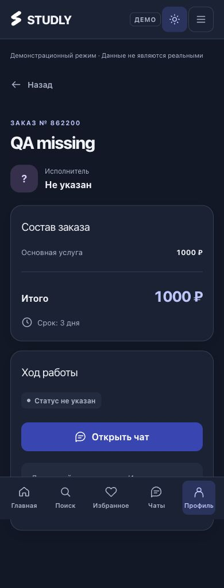
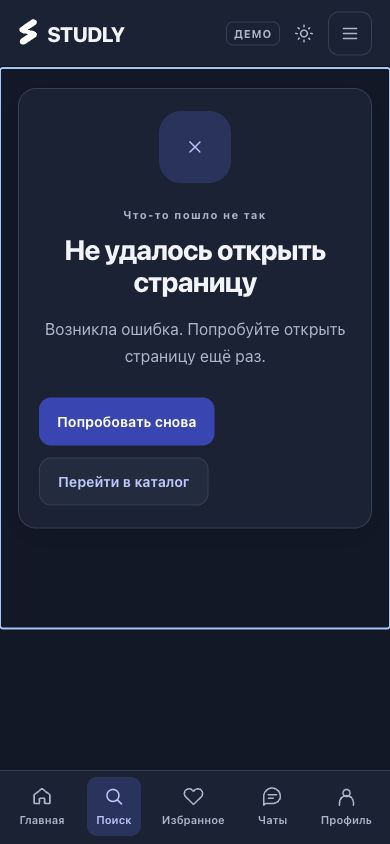

# Доказательства исправлений приёмки — 22.10.2026

[Подробный отчёт](../../2026-10-22_02-55_technical-acceptance-fixes.md).

## Скриншоты

| Сценарий | Скриншот |
|---|---|
| Неполный заказ, 390 px, dark | [Открыть](order-missing-dark-390.jpg) |
| Error boundary услуги: main в фокусе, 390 px, dark | [Открыть](service-error-dark-390.jpg) |
| Список всех QA-статусов, 320 px, light | [Открыть](orders-list-light-320.jpg) |
| Связанный чат без имени/статуса, 390 px, light | [Открыть](chat-missing-light-390.jpg) |
| Список заказов, desktop | [Открыть](orders-list-desktop.jpg) |
| Search error с фокусируемым main, desktop | [Открыть](search-error-focused-desktop.jpg) |
| Чистый /search, 1440 px, light | [Открыть](search-light-1440.jpg) |
| Чистая /service/1, 1440 px, light | [Открыть](service-light-1440.jpg) |

## Машинные результаты

- [20 деталей/чатов, ошибки/reset/focus, переходы и сообщение](browser-evidence.json).
- [48 responsive/theme проверок](responsive.json).
- [22 маршрута и 404](route-smoke.json).
- [Before/after hashes и новые файлы](preservation.json).
- [P2 до исправления](studly-r1-before.txt), [P2 после](studly-r1-after.txt), [91 итоговый тест](studly-fixes-tests.log).
- [ESLint](studly-fixes-lint.log).
- [Чистый Demo build](studly-fixes-demo-build.log), [Live build](studly-fixes-live-build.log), [финальный Demo build](studly-fixes-final-demo-build.log).
- [Изолированный append-only seed](demo-seed.html.txt), [временный one-shot fault gate](boundary-fault-gate.tsx.txt). Это архив тестовой оснастки: в public/src приложения этих QA-файлов нет.

Full-page screenshot фиксированной нижней навигации показывает её на позиции viewport; прокрутка ниже этой позиции остаётся доступной. JSON responsive содержит фактические размеры браузера. Скриншоты и fixture — исключительно локальные синтетические Demo-данные.
